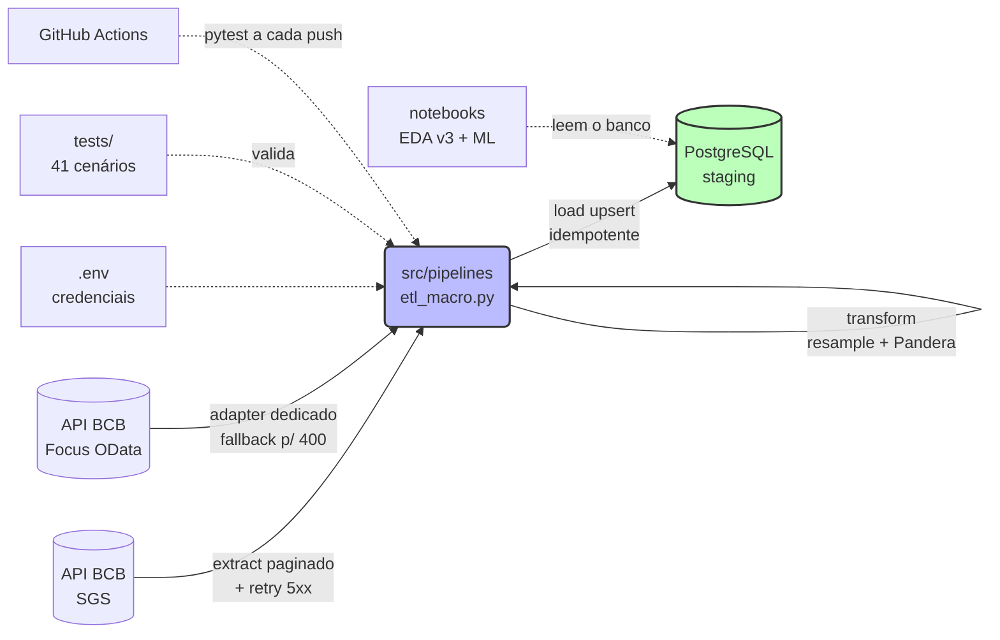

# 🇧🇷 Análise do Brasil — Pipeline de Dados Macroeconômicos

Pipeline ETL em Python que extrai **7 indicadores macroeconômicos** de duas APIs
do Banco Central (SGS + Expectativas Focus), consolida em base mensal única
(2000→hoje), valida com contratos de dados (Pandera) e carrega em PostgreSQL —
com 41 testes, monitoramento, Docker, carga incremental, EDA econometricamente
cuidadoso e um experimento de baseline ML com rolling origin. Serve de base
para o deploy em nuvem (Supabase + GitHub Actions) e consumo futuro via API/LLM.

---

## 🛠️ Tech Stack

- **Linguagem:** Python 3.14 (testada — Dockerfile e CI usam a mesma)
- **Dados:** Pandas, NumPy, statsmodels (ADF/ARIMA), scikit-learn (Ridge)
- **Banco:** PostgreSQL (SQLAlchemy + psycopg2)
- **Qualidade:** Pandera (contratos), pytest (41 testes, validados por mutation testing)
- **Infra:** Docker + Docker Compose, GitHub Actions (CI de testes)
- **Análise:** Jupyter, Matplotlib, Seaborn

## 🏗️ Arquitetura



### Estrutura de Pastas

```
Analise-Brasil/
├── .env / .env.example
├── docker-compose.yml        # Postgres oficial (porta 5433)
├── Dockerfile
├── requirements.txt
├── README.md
├── .github/workflows/        # CI: pytest a cada push
├── notebooks/
│   ├── eda_v3.ipynb          # EDA com correções econométricas (meta por ano,
│   │                         #   variações + ADF, corte comum, lags-fonte-única)
│   └── ml_baselines.ipynb    # rolling origin 24m, seleção por fold,
│                             #   shifts de disponibilidade, vereditio
├── src/
│   ├── main.py               # entrypoint (incremental por padrão, --full p/ backfill)
│   ├── database/db.py        # get_engine() — conexão única, lru_cache
│   ├── adapters/
│   │   ├── bcb_api.py        # cliente SGS: retry, backoff, tratamento 5xx/HTML
│   │   └── focus_api.py      # cliente OData Expectativas: paginação $skip,
│   │                         #   fallback p/ filtro rejeitado pelo proxy
│   └── pipelines/etl_macro.py  # extract → transform → load + registrar_execucao
└── tests/
    └── test_transform.py     # 41 cenários (golden, fronteiras, fail-fast)
```

## 🚀 Como Rodar

```bash
docker compose up -d db          # Postgres oficial (localhost:5433)
cp .env.example .env             # preencha com seus valores

python -m src.main               # carga incremental (padrão)
python -m src.main --full        # backfill completo desde 2000

python -m pytest -v              # 41 testes
jupyter notebook notebooks/      # EDA e ML
```

Conexão DBeaver: host `localhost`, porta `5433`, banco `macro`.

---

## 📖 Dicionário de Dados — `staging.indicadores_macro`

| Coluna | Tipo (Postgres) | Unidade | Fonte | Regra de negócio |
|---|---|---|---|---|
| `data` | `DATE` (PK) | mês (dia 01) | — | Chave primária; `resample("MS")`; duplicata → primeira ocorrência vence |
| `taxa_selic` | `NUMERIC(14,4)` | % a.a. | SGS 432 | Último valor do mês (`last`); range 0–60 |
| `ipca_pct` | `NUMERIC(14,4)` | % m/m | SGS 433 | Valor do mês; publica dia ~10; range −5–30 |
| `cambio_usd` | `NUMERIC(14,4)` | R$/USD | SGS 1 | Média dos pregões do mês (`mean`); range 0–20 |
| `igpm` | `NUMERIC(14,4)` | % m/m | SGS 189 | Fecha dia ~30; range −10–40; **nowcast, não preditor** (lag 0 = concorrência) |
| `ibcbr` | `NUMERIC(14,4)` | índice (base 100) | SGS 24364 (ajustado sazonalmente) | Início 2003 (API 404 antes); range 50–300; **publica ~2 meses depois** → lag 3 |
| `desemprego` | `NUMERIC(14,4)` | % da PEA | SGS 24369 (PNAD-C) | Início 2012; range 0–30; publica ~1 mês → lag 2 |
| `ipca_focus` | `NUMERIC(14,4)` | % acum. 12m | Boletim Focus (OData) | Mediana do mercado p/ o ano de `Data + 12m`; semanal → `last` do mês; range 0–30 |

**Regras transversais:** join `outer` por mês (nulo = série não publicou, não é erro);
carga idempotente (`ON CONFLICT (data) DO UPDATE`); validação Pandera antes de qualquer
gravação; **disponibilidade real** (atraso de publicação) definida aqui e respeitada no ML.

---

## ⚙️ Decisões Técnicas (e os porquês)

| Decisão | Motivo |
|---|---|
| **Paginação por ano + retry (5xx/HTML)** | API do BCB é pública e instável: 502/503 acontecem; timeout de payload longo era certeiro |
| **Carga incremental + `--full` explícito** | Extrair 26 anos sempre era desperdício; reprocessamento total virou decisão consciente |
| **`inicio` por série no config** | A API retorna 404 (não vazio) fora do período da série; o início declarado documenta cobertura |
| **IBC-Br = 24364, não 4380** | 4380 era PIB mensal nominal — correlacionava com IPCA por construção (espúrio); corrigido após revisão |
| **Focus em adapter OData dedicado** | API diferente do SGS ($filter/$skip); mesmo contrato de saída — o transform não percebe |
| **Fallback sem filtro no Focus** | O proxy OData rejeita o $filter esporadicamente (400) mesmo com query válida no navegador |
| **`keep="first"` em duplicatas** | Regra documentada: primeira ocorrência na ordem de chegada vence (testada) |
| **Join outer + nullable no Pandera** | Séries publicam em dias diferentes; nulo isolado é estrutural, nulo em tudo seria erro |
| **Pandera com ranges por tipo** | Taxas têm teto econômico; o IBC-Br deixou de ser "nível" quando virou índice |
| **Sem migrations (por enquanto)** | Adicionar coluna = DROP + `--full` em dev; Alembic entra quando houver produção real |

---

## 🛡️ Governança e Qualidade

### ✅ Implementado

- **Qualidade:** contratos Pandera + **dicionário de dados versionado** (coluna, tipo, unidade, fonte, regra)
- **Testes:** 41 cenários — golden, fronteiras, fail-fast, embaralhamento (validados por mutation testing)
- **Monitoramento das execuções:** tabela de auditoria `staging.execucoes` (linhas lidas/carregadas, status, duração, erro)
- **Segurança:** credenciais em `.env` (fora do Git e do build Docker)

### 🔜 Próximos níveis

- Linhagem de dados e versionamento de schema (Alembic)
- SLA de atualização (alerta se `MAX(data)` atrasar além do esperado por série)
- Camada `analytics` (views de consumo para ML/API)

---

## 📈 Resultado do Baseline ML (rolling origin, últimos 24 meses)

Alvo: IPCA do mês seguinte. Seleção de features **por fold** (sem vazamento),
shifts de **disponibilidade real** (publicação), fallback pra naive em NaN.

| Modelo | MAE (p.p.) |
|---|---|
| **Média móvel 12m** | **0.279** 🏆 |
| ARIMA(1,1,1) | 0.297 |
| Ridge (top-3 features por fold) | 0.304 |
| naive | 0.351 |

**Vereditio:** as variáveis econômicas agregam informação real (Ridge > naive), mas a
**persistência de nível domina o horizonte de 1 mês**. Previsão mensal pontual tem teto
baixo — o ganho potencial está no horizonte acumulado 12m (onde `ipca_focus` em nível
deve brilhar) e em nowcast. Hipóteses v2 registradas no notebook.

---

## 🗺️ Roadmap

| Etapa | Status | Conteúdo |
|---|---|---|
| 1. Robustez local | ✅ | 41 testes, Pandera, monitoramento, 7 séries, incremental |
| 1.5. EDA | ✅ | v3: meta por ano, variações + ADF, corte comum, lags com fonte única |
| 2. Docker | ✅ | Dockerfile + compose, banco oficial unificado (5433) |
| 2.5. CI | ✅ | GitHub Actions: pytest a cada push |
| 2.6. ML baseline | ✅ | Rolling origin + seleção por fold + disponibilidade; vereditio honesto |
| 3. Cloud | ⏭️ | Supabase (free tier) + Actions agendado (ETL diário) |
| 4. ML v2 | ⏭️ | Alvo acumulado 12m, híbrido MM+resíduo, Focus em nível, DXY |
| 5. Consumo | ⏭️ | FastAPI + dashboard; LLM com text-to-SQL sobre camada `analytics` |

> **Regra do projeto:** dados governados antes de ML — modelo em cima de dado
> sem qualidade é lixo bonito. LLM nunca acessa `staging` diretamente.

---

## 📋 Convenções do projeto

- Mensagens de commit: imperativo, uma linha (`"Adiciona X"`, `"Corrige Y"`)
- `.env` nunca versionado; `.env.example` com placeholders sempre atualizado
- `docker compose config` é leitura — **nunca** redirecionar para o `docker-compose.yml`
- Datas que cruzam fronteiras (banco, API, índice) passam por `pd.to_datetime`
- Notebooks versionados sem outputs (`nbstripout --install`)
