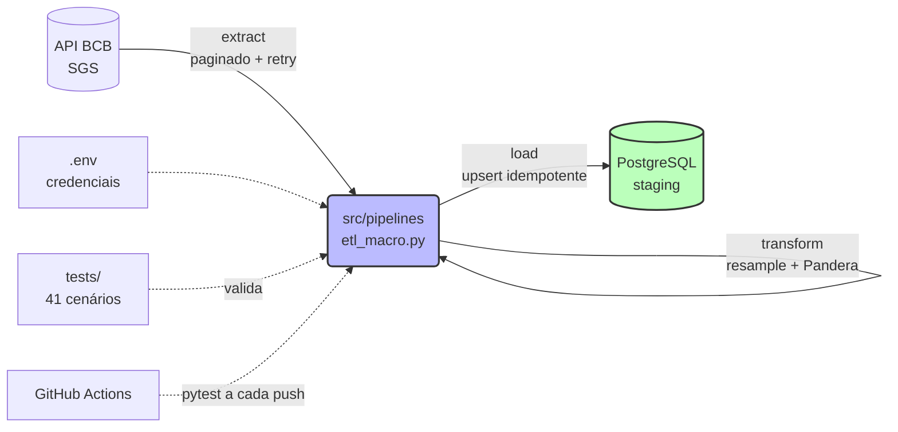

# 🇧🇷 Análise do Brasil — Pipeline de Dados Macroeconômicos

Pipeline ETL em Python que extrai **5 indicadores macroeconômicos** da API do
Banco Central do Brasil (SGS), consolida em base mensal única (2000→hoje),
valida com contratos de dados (Pandera) e carrega em PostgreSQL — com testes
(41 cenários), observabilidade, Docker e carga incremental. Serve de fundação
para análise (EDA), modelos preditivos de inflação e, futuramente, consumo
via API/LLM.

---

## 🛠️ Tech Stack

- **Linguagem:** Python 3.14 (testada — Dockerfile e CI usam a mesma)
- **Dados:** Pandas, NumPy
- **Banco:** PostgreSQL (SQLAlchemy + psycopg2)
- **Qualidade:** Pandera (contratos de dados), pytest (41 testes, validados por mutation testing)
- **Infra:** Docker + Docker Compose, GitHub Actions (CI de testes)
- **Análise:** Jupyter, Matplotlib, Seaborn

## 🏗️ Arquitetura



### Estrutura de Pastas

```
Analise-Brasil/
├── .env                  # credenciais (NÃO versionar; ver .env.example)
├── .env.example          # template das variáveis
├── docker-compose.yml    # Postgres + ETL (banco oficial: porta 5433)
├── Dockerfile
├── requirements.txt
├── README.md
├── .github/workflows/    # CI: testes a cada push
├── notebooks/
│   └── eda.ipynb         # análise exploratória (322 meses, 5 séries)
├── src/
│   ├── main.py           # entrypoint (incremental por padrão, --full p/ backfill)
│   ├── database/db.py    # get_engine() — conexão única, lru_cache
│   ├── adapters/bcb_api.py   # cliente SGS: retry, backoff, tratamento 5xx
│   └── pipelines/etl_macro.py  # extract → transform → load + registrar_execucao
└── tests/
    └── test_transform.py # 41 cenários (golden, fronteiras, fail-fast)
```

### Fontes de Dados

| Indicador | Série SGS | Periodicidade | Agregação mensal | Coluna |
|---|---|---|---|---|
| SELIC | 432 | diária | `last` (último do mês) | `taxa_selic` |
| IPCA | 433 | mensal | `last` | `ipca_pct` |
| Câmbio USD/BRL | 1 | diária | `mean` (média do mês) | `cambio_usd` |
| IGP-M | 189 | mensal | `last` | `igpm` |
| IBC-Br | 4380 | mensal | `last` | `ibcbr` |

> ⚠️ `DATA_INICIAL = 2000` e join **outer**: cada série entra com o que tem —
> nulos no fim da amostra são estruturais (IBC-Br atrasa ~2 meses, IPCA sai
> dia ~10). O Pandera trata isso: taxas com range fixo, níveis com check de
> variação mensal máxima.

## 🚀 Como Rodar

### Pré-requisitos
- Docker Desktop (banco oficial do projeto)
- Python 3.14 (para rodar o pipeline/notebook fora do container)

### Subir o banco e rodar

```bash
docker compose up -d db                 # Postgres oficial (localhost:5433)

cp .env.example .env                    # preencha com seus valores

python -m src.main                      # carga incremental (padrão)
python -m src.main --full               # backfill completo desde 2000

python -m pytest -v                     # 41 testes
```

### Conectar no DBeaver

Host `localhost`, porta `5433`, banco `macro`, usuário/senha conforme `.env`.

### EDA

```bash
jupyter notebook notebooks/eda.ipynb    # ou abra no PyCharm/VS Code
```

O notebook lê o banco via `get_engine()` — quando migrar pro Supabase, só o
`.env` muda.

---

## ⚙️ Decisões Técnicas (e os porquês)

| Decisão | Motivo |
|---|---|
| **Paginação por ano + retry (5xx/HTML)** | API do BCB é pública e instável: 502/503 acontecem; timeout de payload longo era certeiro |
| **Carga incremental + `--full` explícito** | Extrair 26 anos sempre era desperdício; reprocessamento total virou decisão consciente, nunca acidente |
| **`keep="first"` em duplicatas** | Regra documentada: primeira ocorrência na ordem de chegada vence (testada) |
| **Join outer + nullable no Pandera** | Séries publicam em dias diferentes; mês com série única existe, com nulo nas demais |
| **Upsert (`ON CONFLICT DO UPDATE`)** | Idempotência: rodar N vezes = rodar 1 |
| **Transação única no load** | `engine.begin()`: erro em qualquer ponto = rollback total |
| **`get_engine()` com lru_cache** | Uma conexão por processo; troca local ↔ Supabase = só mudar `.env` |
| **Pandera com ranges por tipo** | Taxas (SELIC/IPCA) têm teto econômico; níveis (IBC-Br) crescem — variação mensal >50% é o sinal real de erro |

---

## 🛡️ Governança e Qualidade

### ✅ Implementado

- **Testes:** 41 cenários — golden test, fronteiras de range, fail-fast (valor/data/ série vazia), embaralhamento, duplicatas. Validados por mutation testing (quebrar `.last()`→`.first()`, remover `sort`/`drop_duplicates` → testes detectam)
- **Contratos (Pandera):** unicidade de datas, ranges por coluna, checagem de variação mensal para níveis
- **Observabilidade:** logs estruturados + tabela `staging.execucoes` (linhas lidas/carregadas, status, duração, erro) — toda execução deixa rastro
- **Segurança:** credenciais em `.env` (fora do Git e do build Docker)

### 🔜 Próximos níveis

- Linhagem de dados (de qual série vem cada coluna, versionamento)
- SLA de atualização (alerta se `MAX(data)` atrasar além do esperado por série)
- Camada `analytics` (views de consumo para ML/API)

---

## 🗺️ Roadmap

| Etapa | Status | Conteúdo |
|---|---|---|
| 1. Robustez local | ✅ | 41 testes, Pandera, observabilidade, 5 séries, incremental |
| 1.5. EDA | ✅ | `notebooks/eda.ipynb` — sazonalidade, volatilidade, lags → features |
| 2. Docker | ✅ | `Dockerfile` + `docker-compose.yml`, banco oficial unificado (5433) |
| 2.5. CI | ✅ | GitHub Actions roda pytest a cada push |
| 3. Cloud | ⏭️ | Supabase (free tier) + GitHub Actions agendado (ETL diário) |
| 4. ML | ⏭️ | Baselines (naive, média móvel 12m, ARIMA) vs IPCA, rolling origin; features do EDA |
| 5. Consumo | ⏭️ | FastAPI + dashboard; LLM com text-to-SQL sobre camada `analytics` |

> **Regra do projeto:** dados governados antes de ML — modelo em cima de dado
> sem qualidade é lixo bonito. LLM nunca acessa `staging` diretamente.

---

## 📋 Convenções do projeto

- Mensagens de commit: imperativo, uma linha (`"Adiciona X"`, `"Corrige Y"`)
- `.env` nunca versionado; `.env.example` com placeholders sempre atualizado
- `docker compose config` é leitura — **nunca** redirecionar para o `docker-compose.yml`
- Datas que cruzam fronteiras (banco, API, índice) passam por `pd.to_datetime` antes de `.dt`
